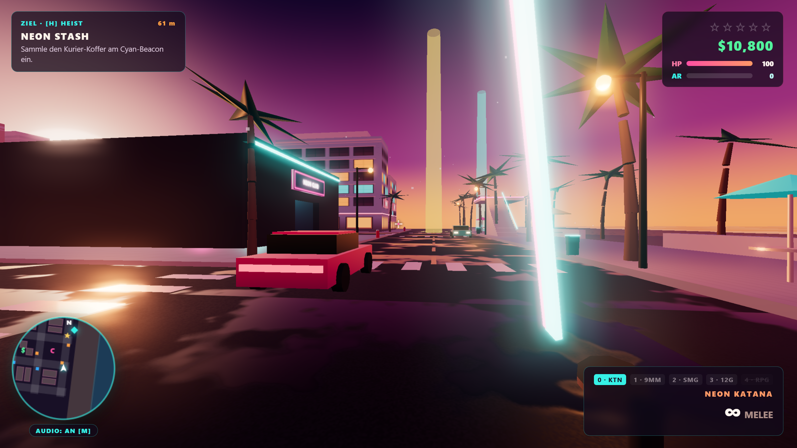
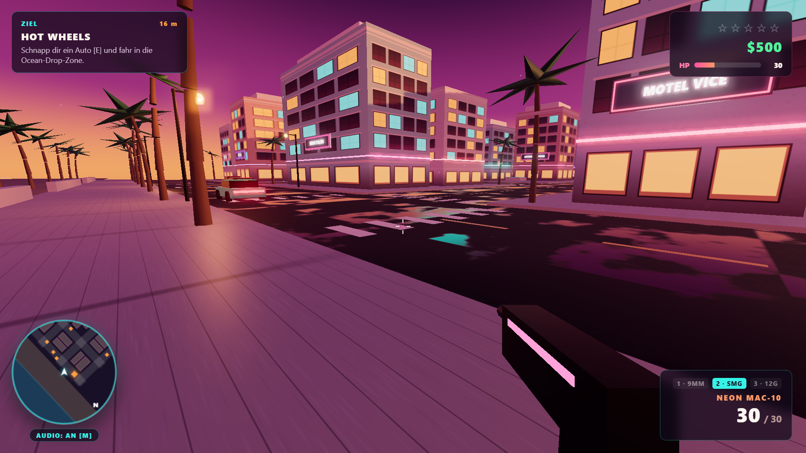

# VICE DUSK — Browser First-Person Shooter

Ein kompakter **GTA-inspirierter First-Person Shooter im Browser**, angesiedelt in einem sonnengebleichten Küstenviertel im **Miami-Stil zur Golden Hour / Dämmerung kurz nach einem Regenschauer**.

Gebaut mit **Three.js**, **TypeScript**, **Vite** und der **Web Audio API** — komplett ohne externe 3D-, Textur- oder Audio-Assets.




---

## Features

- **Miami Coastal District (3×3 Blocks + Ocean Drive & Strand):**
  - Prozedurale Art-Deco-Pastellfassaden, leuchtende Neon-Schilder (`HOTEL PALMA`, `OCEAN CLUB`, `CAFE SOL`, `MOTEL VICE`, …), begehbare Gassen und zwei beleuchtete **Aussichtsdecks mit Außentreppen**.
  - **Nasser Post-Rain-Asphalt** mit prozeduraler Pfützen-Roughness-Map und `PMREMGenerator`-Reflexionen, Palmen im Küstenwind, Straßenlaternen, Strand & animierter Dusk-Ozean-Shader + `UnrealBloomPass`.
  - **Tageszeit & Wetter live umschaltbar:** `T` wechselt zwischen *Golden Hour*, *Miami Sunset* und *Neon Night*; `Y` startet einen **Tropenschauer** mit 3D-Regenstreifen, Wetterleuchten und fernem Donner.
  - **Zerstörbare Street-Props:** Feuerhydranten (mit 11s-Wasserfontäne!), Café-Tische mit Pastell-Sonnenschirmen und Neon-Mülltonnen.
- **First-Person-Gunplay (4 Waffen) & Drive-By:**
  - **Vice 9mm**, **Neon Mac-10 (SMG)**, **Palm 12G (Shotgun)** und der im Shop freischaltbare **Neon Launcher (`4 · RPG`)** mit Flächenschaden.
  - 3D-Viewmodels mit Sway, Rückstoß, Mündungsfeuer, ADS-Zoom (`RMB`), Nachladen (`R`), Tracern, Funken & Hitmarkern.
  - **Drive-By-Schießen:** Während der Fahrt mit `LMB` aus dem Fahrerfenster feuern.
- **Fahrbare Retro-Autos, Kollisionsphysik & Speedboat:**
  - 8 Retro-Fahrzeuge (u. a. *Cheetah GT*, *Infernus 86*, *Solaris Cabrio*, *Vice PD Cruiser* & *Interceptor* + Verkehr) mit **solider Auto-zu-Auto-Kollision**, geschwindigkeitsabhängigem **Crash-Schaden**, Rauch/Feuer und **Explosionen mit Kettenreaktionen**.
  - Dynamischer **Scheinwerfer-Lichtkegel (`SpotLight`)**, Drift-Rauch & Reifenquietschen (`Space`), umschaltbare **Chase-/Cockpit-Kamera (`V`)** und **Pay ’n’ Spray Lackiererei (`F`)** zum Reparieren, Umlackieren & Sterne-Löschen.
  - **Stinger Speedboat** direkt am Strandufer (`E`) für rasante Fahrten mit Gischtspur über den Dusk-Ozean.
- **Vice-City-Charaktere, Polizei-KI, Helikopter & Kleine Ziele:**
  - Prozedural texturierte, animierte Charaktere (80s-Sonnenbrillen, Hawaii-Hemden, Pastell-Sakkos, Vice-PD-Uniformen & Syndikat-Anzüge).
  - **1–5 Wanted-Sterne:** Verfolgende Vice-PD-Einheiten zu Fuß, aktive **Polizei-Streifenwagen** ab 2 Sternen und ein abschießbarer **Vice-PD-Helikopter mit Suchscheinwerfer** ab 3 Sternen.
  - **5 rotierende Mini-Missionen** mit 3D-Neon-Beacon (*Neon Stash*, *Ocean Drive Sprint*-Zeitrennen, *Syndikat-Ziel*, *Hot Wheels Drop-Off*, *Heat Survival*).
  - **AMMU-NEON Shop (`B` am Central Plaza):** Medkits, Kevlar-Rüstung (`AR`-Balken) und der *Neon Launcher*.
- **Miami-Radar, 80s-Auto-Radio & Persistenz:**
  - Mitdrehende Minimap mit Gebäuden, Straßen, Fahrzeugen, `$`-Shop, `P`-Pay-’n’-Spray, `H`-Helikopter & Zielmarker.
  - Prozedurale **Web-Audio-Engine** (Schüsse, Crash, Explosionen, Sirenen, Donner, Motor, nasse Schritte) + **3 Synthwave-Radiosender (`Q`)**: *VICE FM*, *DUSK CHILL*, *OUTRUN TURBO*.
  - Pause-Menü mit **Maus-Sensitivität**, getrennter **SFX-/Musik-Lautstärke**, **Performance-Modus** und automatischem **`localStorage`-Speicherstand**.

---

## Steuerung

| Taste | Aktion |
| :--- | :--- |
| `W` `A` `S` `D` | Bewegen / Fahren / Boot steuern |
| `Maus` | Umsehen / Zielen |
| `Linksklick` / `Rechtsklick` | Schießen (auch Drive-By) / Zielen (ADS) |
| `1` `2` `3` `4` / `Mausrad` | Waffe wechseln (9mm / SMG / Shotgun / Launcher) |
| `R` | Nachladen |
| `Shift` / `C` | Sprinten / Ducken |
| `Space` | Springen / Drift-Handbremse im Auto |
| `E` | Auto oder Speedboat ein- / aussteigen |
| `V` | Kamera im Auto wechseln (Chase / Cockpit) |
| `Q` | 80s-Radio-Sender wechseln |
| `F` | Pay ’n’ Spray nutzen (im Auto in der Bucht) |
| `B` | AMMU-NEON Shop öffnen (am Central Plaza) |
| `T` / `Y` | Tageszeit wechseln / Tropenschauer an & aus |
| `M` | Audio stummschalten |
| `ESC` | Pause & Einstellungen |

---

## Lokal starten

Voraussetzung: **Node.js 18+**

```bash
npm install
npm run dev
```

Danach im Browser öffnen: `http://localhost:5173/`

### Production-Build

```bash
npm run build
npm run preview
```

---

## Projektstruktur

```text
src/
├── audio/
│   └── AudioEngine.ts         # Prozedurale Web-Audio-SFX, Crash, Donner, Sirene & 80s-Radio
├── combat/
│   └── WeaponSystem.ts        # 4 Waffen-Viewmodels, Hitscan/RPG-Explosionen & Drive-By
├── engine/
│   ├── Physics.ts             # AABB-Kollision mit Wall-Sliding & Treppen/Bordstein-Step-Up
│   └── Storage.ts             # localStorage-Speicherstand & Live-Einstellungen
├── entities/
│   ├── CharacterTextures.ts   # Prozedurale Gesichts- & 80s-Outfit-Texturen
│   ├── HelicopterSystem.ts    # Vice-PD-Helikopter mit Suchscheinwerfer & Abschuss
│   └── NpcSystem.ts           # Artikulierte Passanten, Vice-PD-KI & Syndikat-Ziele
├── gameplay/
│   ├── ObjectiveSystem.ts     # 5 rotierende Mini-Missionen & 3D-Neon-Beacon
│   ├── PayNSpray.ts           # Lackiererei (Reparatur, Neulack & Sterne löschen)
│   ├── ShopSystem.ts          # AMMU-NEON Upgrade-Kiosk am Central Plaza
│   └── WantedSystem.ts        # 1–5 Wanted-Sterne & Heat-Abbau
├── hud/
│   └── Minimap.ts             # Mitdrehendes Miami-Radar (2D-Canvas)
├── player/
│   └── PlayerController.ts    # Pointer-Lock FPS-Controller mit Fallback-Steuerung
├── vehicles/
│   ├── BoatSystem.ts          # Fahrbares Stinger Speedboat am Strand
│   └── VehicleSystem.ts       # Retro-Autos, Kollisionen, Crash-Schaden, Explosionen & Polizei-Jäger
├── world/
│   ├── CityBuilder.ts         # 3×3 Miami-Welt, Terrassen, Wetter, Tageszeit, Palmen & Ozean
│   ├── CityLayout.ts          # Deterministisches Stadt-Layout
│   ├── DestructibleProps.ts   # Zerstörbare Hydranten (Wasserfontäne), Cafés & Mülltonnen
│   └── Textures.ts            # Prozedurale Pfützen-, Fassaden- & Neon-Schild-Texturen
└── main.ts                    # Game-Loop, Post-Processing (Bloom) & HUD-Wiring
```

---

## Tech-Stack

- [Three.js](https://threejs.org/) (WebGL2 + `EffectComposer` / `UnrealBloomPass`)
- [TypeScript](https://www.typescriptlang.org/)
- [Vite](https://vite.dev/)
- Web Audio API & HTML5 Canvas (prozedurale Texturen & Radar)
