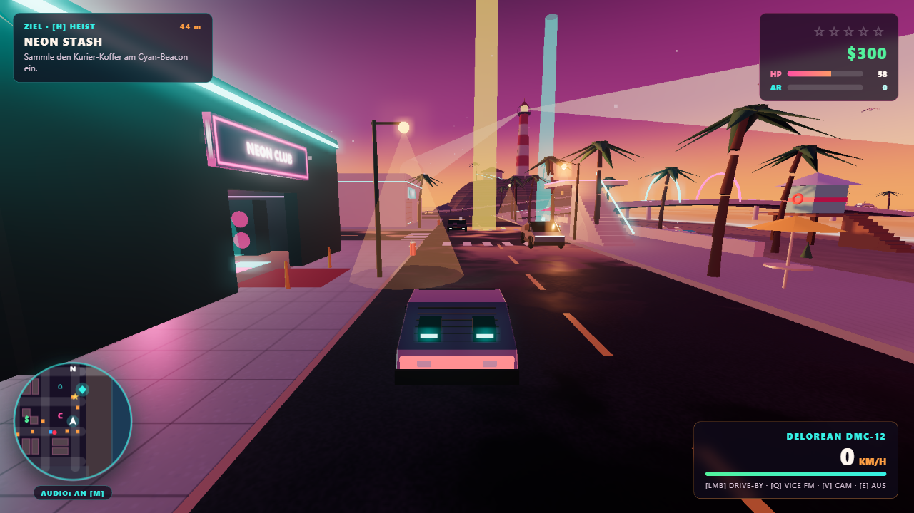

# VICE DUSK — Browser First-Person Shooter

Ein kompakter **GTA-inspirierter First-Person Shooter im Browser**, angesiedelt in einem sonnengebleichten Küstenviertel im **Miami-Stil zur Golden Hour / Dämmerung kurz nach einem Regenschauer**.

Gebaut mit **Three.js**, **TypeScript**, **Vite** und der **Web Audio API** — komplett ohne externe 3D-, Textur- oder Audio-Assets.

> **Live spielen (GitHub Pages):** `https://strangeoptics.github.io/gta_browser/` *(aktivierbar unter Repo Settings → Pages → Source: GitHub Actions)*




---

## Features

- **Miami Coastal District (3×3 Blocks + Abschüssiger Strand & NEON CLUB):**
  - Prozedurale Art-Deco-Pastellfassaden, leuchtende Neon-Schilder, zwei **Aussichtsdecks**, funktionierende **Ampeln** an den 4 Hauptkreuzungen, Post-Rain-**Laternen-Dunst** und **Neon-Stunt-Rampen** (*INSANE STUNT BONUS!*).
  - **Abschüssiger Miami Beach:** Sanft abfallende Dünen mit spiegelndem **nassem Ufersand**, halbtransparenter Brandung, **South-Beach-Lifeguard-Turm** (begehbar), beleuchtetem **Holzsteg zum Speedboat**, Sonnenliegen, Beachvolleyball-Netz, kreisenden **Möwen** & räumlichem **Meeresrauschen**.
  - **Begehbarer NEON CLUB (`C`):** Rotierende **Spiegel-Discokugel**, 4 bis zum Boden reichende **Effektstrahler**, beleuchtete Bar mit **Barkeeper & Miami Vice Cocktails (`F`)**, DJ-Pult mit basspulsierenden **Subwoofer-Türmen**, 5 Tänzer und **räumliche 126-BPM-Clubmusik**.
  - **Tageszeit, Wetter & Zerstörung:** `T` (Golden Hour / Sunset / Neon Night), `Y` (Tropenschauer mit Blitz & Donner), zerstörbare Hydranten (mit Wasserfontäne!), Café-Tische & Mülltonnen.
- **First- & Third-Person-Gunplay (5 Waffen inkl. Nahkampf) & Drive-By:**
  - Umschaltbar zu Fuß per **`V`** zwischen **First-Person** und **3rd-Person (Over-the-Shoulder mit 80s-Spielermodell)**.
  - **Neon Katana (`0`)**, **Vice 9mm (`1`)**, **Neon Mac-10 SMG (`2`)**, **Palm 12G Shotgun (`3`)**, **Neon Launcher (`4 · RPG`)** + **Drive-By-Schießen (`LMB`)** aus dem Fahrzeug.
- **Fahrbare Retro-Autos, 80s-Motorrad („PCJ-86“), Speedboat & Polizei-Eskalation:**
  - 9 Fahrzeuge inkl. **PCJ-86 Neon-Motorrad** (mit Kurven-Schräglage & 3D-Fahrer), Auto-zu-Auto-Kollisionen, geschwindigkeitsabhängigem Crash-Schaden, **Explosionen**, **Brems- & Rückfahrlichtern**, Drift-Rauch & Skidmarks, **Pay ’n’ Spray (`F`)** sowie dem **Stinger Speedboat** am Pier.
  - **1–5 Wanted-Sterne:** Personen-Kollisionen, verfolgende **Vice-PD-Streifenwagen** (ab 2★), **Polizei-Straßensperren** & abschießbarer **Vice-PD-Helikopter mit Suchscheinwerfer** (ab 3★) plus **Polizeifunk**.
- **Eigene Basis — VICE SAFEHOUSE (`⌂` am Nord-Ocean-Drive):**
  - Begehbare 2-Ebenen-Art-Deco-Villa mit **automatischem Rolltor** (private Garage mit engem Nahbereichs-Sensor), **automatischen Glasschiebe- & Innentüren**, Lounge (Sofa, **einschaltbarer 80s-CRT-TV „VICE CHANNEL 6“**, **öffenbarer Waffenschrank** mit allen 5 3D-Waffen, Kleiderschrank, Tresor), **Küchenzeile mit selbstöffnendem Kühlschrank** und **Penthouse-Dachterrasse mit eingelassenem, begehbarem Pool** inkl. Unterwasser-Stufen.
  - **Interaktive Gameplay-Funktionen:**
    - **VICE CHANNEL 6 News-TV:** Fadenkreuz auf den Fernseher richten (wechselt zur **3D-Hand**) und per **`LMB` / `F`** ein- oder ausschalten — animierter 80s-Nachrichtensprecher, dynamischer Breaking-News-Ticker (reagiert auf Wanted-Sterne & Cash), Synth-Intro-Jingle & echte `en-US`-Sprachausgabe (`Web Speech API`).
    - **Küche & Kühlschrank:** 10 essbare Snacks & Drinks im Kühlschrank und auf der Theke — beim Anvisieren erscheint die **3D-Hand** zum Nehmen & Essen (`LMB` / `F`, auch bei 100 % HP).
    - **Waffenschrank:** Doppeltüren öffnen sich automatisch beim Herantreten; anvisierte Waffen können per **3D-Hand** (`LMB` / `F`) direkt ausgerüstet und aufgefüllt werden.
    - **Basis-Services:** Kostenlos **Heilen, Munition auffüllen & Speichern (`F`)** in der Lounge, **4 wechselbare 80s-Outfits (`F`)** am Kleiderschrank (gespeichert in `localStorage`), **gratis Garagen-Reparatur (`F`)**, schnellerer Wanted-Abbau drinnen & Safehouse-Respawn.
- **Story-Heist, Mini-Missionen, Fotomodus (`P`) & Komfort:**
  - **3-stufiger Story-Heist „Ocean Club Finale“ (`H`, `+$3.500`)**, 5 rotierende Mini-Missionen & **AMMU-NEON Shop (`B`)** (Medkits, Kevlar-Armor, Launcher).
  - **Fotomodus (`P`):** Welt einfrieren, freie Flugkamera (`WASD` + `E`/`Q`) und PNG-Screenshot per **`K`** speichern.
  - Miami-Radar, **3 Synthwave-Radiosender (`Q`)**, **Gamepad-Support**, **Mobile/Tablet-Touch-Steuerung**, Vite Code-Splitting & `localStorage`-Speicherstand.

---

## Steuerung

| Taste | Aktion |
| :--- | :--- |
| `W` `A` `S` `D` | Bewegen / Fahren / Boot steuern |
| `Maus` | Umsehen / Zielen |
| `Linksklick` / `Rechtsklick` | Schießen (auch Drive-By) · Interagieren (3D-Hand: Essen, Waffenschrank, TV) / Zielen (ADS) |
| `0` `1` `2` `3` `4` / `Mausrad` | Waffe wechseln (Katana / 9mm / SMG / Shotgun / Launcher) |
| `R` | Nachladen |
| `H` | Ocean Club Story-Heist starten (`+$3.500`) |
| `Shift` / `C` | Sprinten / Ducken |
| `Space` | Springen / Drift-Handbremse im Auto |
| `E` | Auto oder Speedboat ein- / aussteigen |
| `V` | Kamera wechseln (zu Fuß: 1st/3rd-Person · im Auto: Chase/Cockpit) |
| `Q` | 80s-Radio-Sender wechseln |
| `F` | Pay ’n’ Spray / Safehouse (Heilen, Outfit, Garage, Essen, Waffenschrank, TV) / Club-Cocktail |
| `B` | AMMU-NEON Shop öffnen (am Central Plaza) |
| `T` / `Y` | Tageszeit wechseln / Tropenschauer an & aus |
| `P` / `K` | Fotomodus an & aus / PNG-Screenshot im Fotomodus |
| `M` | Audio stummschalten |
| `ESC` | Pause & Einstellungen |

### Gamepad-Steuerung (Xbox / PlayStation)
- **Linker Stick / Rechter Stick:** Analoges Laufen & Lenken / Umsehen
- **RT / LT:** Schießen & Gas / Zielen (ADS) & Bremse/Rückwärts
- **Y (Dreieck):** Auto & Boot ein-/aussteigen · **X (Viereck):** Nachladen / Pay ’n’ Spray
- **A (Kreuz):** Springen / Handbremse · **LB / RB:** Waffen wechseln (im Auto: Radio / Drive-By)
- **Steuerkreuz:** Rechts = Kamera, Hoch = Tageszeit, Runter = Regen · **Start:** Pause

---

## Lokal starten

Voraussetzung: **Node.js 18+**

```bash
npm install
npm run dev
```

Danach im Browser öffnen: `http://localhost:5173/`

### Production-Build

```bash
npm run build
npm run preview
```

---

## Projektstruktur

```text
src/
├── audio/
│   └── AudioEngine.ts         # Prozedurale Web-Audio-SFX, Crash, Donner, Sirene & 80s-Radio
├── combat/
│   └── WeaponSystem.ts        # 5 Waffen-Viewmodels, 3D-Hand-Interaktion, Hitscan/RPG & Drive-By
├── engine/
│   ├── Physics.ts             # AABB-Kollision mit Wall-Sliding & Treppen/Bordstein-Step-Up
│   └── Storage.ts             # localStorage-Speicherstand & Live-Einstellungen
├── entities/
│   ├── CharacterTextures.ts   # Prozedurale Gesichts- & 80s-Outfit-Texturen
│   ├── HelicopterSystem.ts    # Vice-PD-Helikopter mit Suchscheinwerfer & Abschuss
│   └── NpcSystem.ts           # Artikulierte Passanten, Vice-PD-KI & Syndikat-Ziele
├── gameplay/
│   ├── ObjectiveSystem.ts     # 5 rotierende Mini-Missionen & 3D-Neon-Beacon
│   ├── PayNSpray.ts           # Lackiererei (Reparatur, Neulack & Sterne löschen)
│   ├── ShopSystem.ts          # AMMU-NEON Upgrade-Kiosk am Central Plaza
│   └── WantedSystem.ts        # 1–5 Wanted-Sterne & Heat-Abbau
├── hud/
│   └── Minimap.ts             # Mitdrehendes Miami-Radar (2D-Canvas)
├── player/
│   └── PlayerController.ts    # Pointer-Lock FPS-Controller mit Fallback-Steuerung
├── vehicles/
│   ├── BoatSystem.ts          # Fahrbares Stinger Speedboat am Strand
│   └── VehicleSystem.ts       # Retro-Autos, Kollisionen, Crash-Schaden, Explosionen & Polizei-Jäger
├── world/
│   ├── BeachProps.ts          # Lifeguard-Turm, Holzsteg, Sonnenliegen, Volleyball & Möwen
│   ├── CityBuilder.ts         # 3×3 Miami-Welt, abschüssiger Strand, Wetter, Tageszeit & Ozean
│   ├── CityLayout.ts          # Deterministisches Stadt-Layout
│   ├── DecalSystem.ts         # Drift-Skidmarks, Brandspuren & Einschusslöcher
│   ├── DestructibleProps.ts   # Zerstörbare Hydranten (Wasserfontäne), Cafés & Mülltonnen
│   ├── NeonClub.ts            # Begehbarer NEON CLUB (Discokugel, Strahler, Bar, Barkeeper, DJ)
│   ├── RoadblockSystem.ts     # Vice-PD-Straßensperren mit durchbrechbaren Barrikaden
│   ├── Safehouse.ts           # Begehbare VICE SAFEHOUSE Villa (Garage, Küche, Waffenschrank, TV & Dachpool)
│   ├── StuntRamps.ts          # Neon-Stunt-Rampen für Insane Stunt Bonuses
│   ├── Textures.ts            # Prozedurale Pfützen-, Sand-, Fassaden- & Neon-Texturen
│   ├── TrafficLights.ts       # Funktionierende Ampeln an den 4 Hauptkreuzungen
│   └── ViceNewsTv.ts          # Prozeduraler 80s-US-Nachrichtensender (Canvas-Studio, Ticker & Speech API)
└── main.ts                    # Game-Loop, Post-Processing (Bloom) & HUD-Wiring
```

---

## Tech-Stack

- [Three.js](https://threejs.org/) (WebGL2 + `EffectComposer` / `UnrealBloomPass`)
- [TypeScript](https://www.typescriptlang.org/)
- [Vite](https://vite.dev/)
- Web Audio API & HTML5 Canvas (prozedurale Texturen & Radar)
